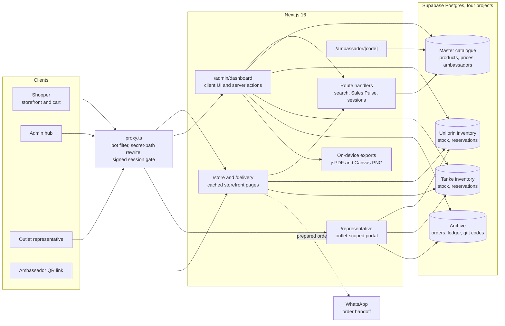
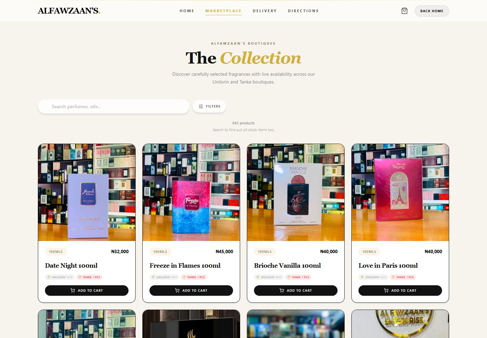
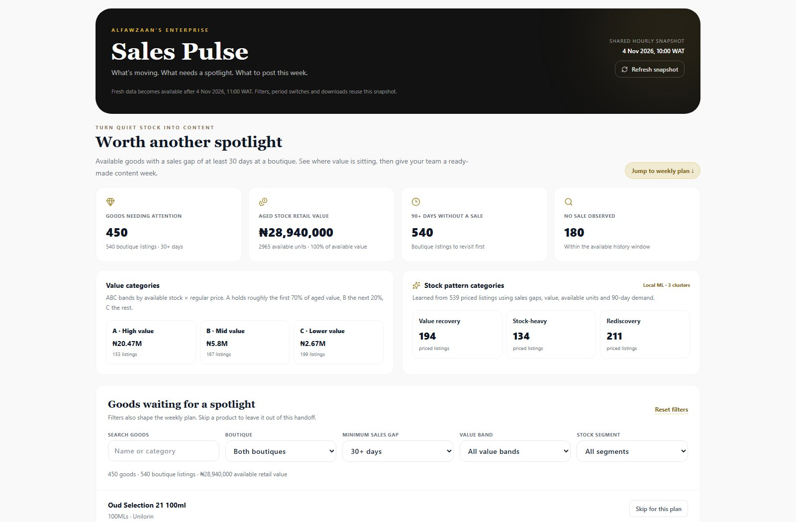
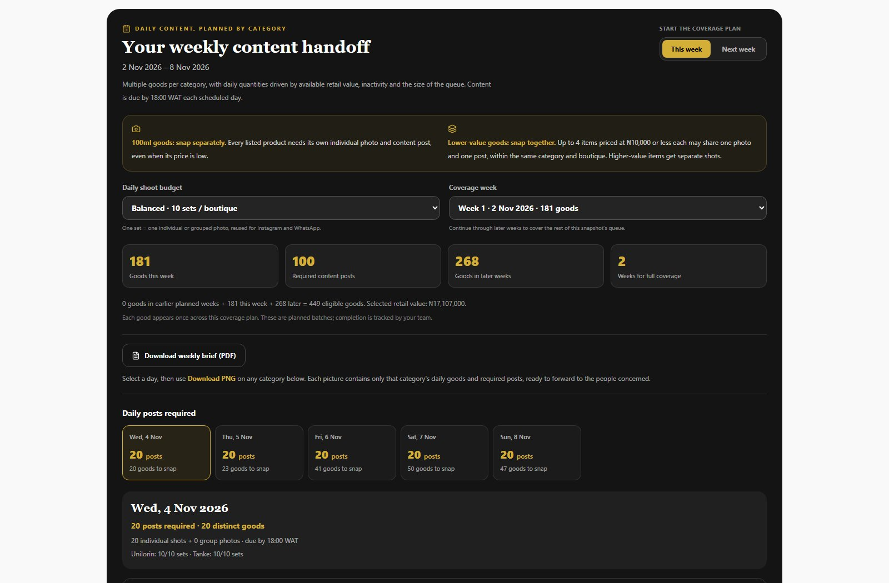

# Alfawzaan's Enterprise

A production fragrance retail platform for two boutiques, **Unilorin** and **Tanke**: a customer storefront, WhatsApp-assisted checkout, and a full operations dashboard for live inventory, order verification, discrepancy tracking, reporting, ambassadors, and gift claims.

The storefront needs no customer account. Shoppers browse real stock from both boutiques, build a cart, choose where to collect, pay by transfer, and hand the prepared order to the correct boutique on WhatsApp.

> **Portfolio copy.** This public version is the application source only. Production credentials, infrastructure identifiers, operational runbooks, database migrations, seed data and deployment configuration are intentionally omitted. The app is not runnable without a Supabase schema that matches the wired actions.

## Project Summary

A two-boutique fragrance retailer runs its whole online operation on this app: a public storefront with live stock from both shops, a WhatsApp handoff instead of a payment gateway, and an operations dashboard where staff verify transfers, reconcile shelf counts, issue receipts and gift codes, track ambassador sales, and build social content plans from slow-moving stock.

The interesting problem is trust without customer accounts. Shoppers never sign in, so every price and stock figure in the browser is treated as a hint: checkout reloads canonical prices, validates availability server-side, and creates the order atomically against the correct boutique. Staff access is gated by a signed session behind a secret URL path, and the data is split across four Postgres projects — catalogue, two outlet inventories, and the order archive — so one shop's activity cannot quietly corrupt another's.

## Architecture



- **Request path:** `proxy.ts` filters scrapers that would burn cache regeneration, rewrites the secret admin and representative paths, and verifies the signed session cookie before either dashboard is served.
- **Data access:** browser code only ever receives anon keys fetched at runtime; every privileged read and write crosses a server action or route handler that holds service-role clients, one per project.
- **Writes:** checkout re-prices and revalidates stock server-side, then an atomic database function creates the order and its items; outlet reservations are the last line against overselling.
- **Exports:** receipts, discrepancy reports, briefs and content sheets are rendered on the device from data already loaded, so generating them costs no server round trip.

## Tech Stack

- **Next.js 16** App Router, **React 19**, TypeScript (strict)
- **Tailwind CSS 4** + daisyUI for the storefront and admin hub
- **Supabase Postgres** across four independent projects (master catalogue, two outlet inventories, order archive), reached only through server-side clients and authenticated server actions
- **jsPDF / jspdf-autotable** for on-device PDF receipts and reports; **Canvas** for text-only PNG content sheets
- **Playwright** browser checks and **node:test** unit tests, with fixture-backed admin flows

## What the Website Is

- **Public storefront** at `/store` with live per-boutique availability, scent discovery, search, filters, and product detail.
- **WhatsApp checkout** that splits an order by boutique when items are stocked in different stores, so each boutique receives only the items it can fulfil.
- **Admin hub** for inventory, sales, flagged goods, orders, receipts, discounts, gift codes, ambassadors, representatives, deliveries, analytics, and data health.
- **Ambassador portal** where campaign partners can see the orders and revenue attributed to their QR code.
- **PDF receipts and reports** generated from real order and stock data.

## Screenshots

The storefront reads live stock from both boutiques:



The admin Sales Pulse turns aged stock into a content plan, with ABC value bands and locally fitted stock clusters:



Every category has its own day-scoped PNG, and the whole week exports as a PDF brief:



The admin screenshots use the fixture data the browser tests run against, so no real customer records appear.

## Unique Features

### Live stock from two real boutiques

Stock is tracked per boutique and per grade (`special`, `extra`, `normal`). The storefront shows what is actually available in Unilorin and Tanke, and checkout re-checks that stock on the server before an order is recorded. A cart is never trusted to know the final price or availability.

Normal browsing loads only in-stock products. A customer search of at least two characters also checks the catalogue for matching sold-out goods, labelled **Out of Stock** with purchasing disabled. These searches are debounced, cached server-side, and paginated; sold-out product details and images are not preloaded with the marketplace. Clearing the search returns to in-stock browsing, and **In Stock Only** skips the additional catalogue search.

If a selection spans both boutiques, checkout separates it into one order per boutique. The buyer sends each boutique its own WhatsApp message, and each order is recorded against the correct store.

### WhatsApp-first ordering without accounts

Buyers do not create an account. The cart prepares a structured order message and opens the device's WhatsApp app chooser on mobile (with a WhatsApp Web fallback on desktop). The boutique verifies the transfer and marks the order paid from the admin or representative dashboard.

### Ambassador QR sales channel

The admin can create ambassadors, generate QR codes, and attach a WhatsApp group to each ambassador. Scanning an ambassador link opens a claim card on the storefront with the ambassador price. Orders placed through the link are attributed in an ambassador redemption ledger and shown in a token-protected ambassador portal.

### Flagged Goods discrepancy register

Daily sales can be flagged when the units remaining **online** disagree with the units counted **physically** on the shelf. Each flag records both counts, the derived direction (`number less`, `number more`, or `matches`), a cause note, recurrence history, and resolution details.

The Flagged Goods tab can:

- Search the catalogue and flag goods directly, without waiting for a sale.
- Show open, resolved, recurring, overdue, and chronic items.
- Resolve, reopen, or correct the online stock to the physical count.
- Export a CSV or a detailed PDF report filtered by status and boutique.

The PDF report includes an executive summary, a plain-language legend, per-store tables, signed unit-gap totals (red for online overstatement, blue for shelf surplus), cause and resolution notes, and page headers for formal handoff.

### Receipts and gift codes

Receipts are generated only on request. A buyer can request one at checkout and provide a receiver name, and an admin can generate one for selected verified sales. The admin Receipt Outbox lists every requested receipt so the boutique can send it through WhatsApp.

A receipt can also carry a one-time gift code. When a verified order qualifies through its Extravaganza perfume purchase, the code is printed on the receipt and becomes claimable only after verification; the admin Gift Claims tab tracks redemption so a code can be used exactly once.

### Operations built for reconciliation

- **Sales Pulse:** aged-stock reminders by boutique, ABC retail-value bands and locally fitted k-means stock patterns. Daily content lists cover 100ml fragrances, miniatures, body/home essentials, Islamic materials and extra goods. Value and inactivity determine balanced quantities; 100ml goods get separate shots and lower-value goods can share grouped photos. Each category has its own day-scoped PNG download, ready to forward to the people concerned. Follow-on coverage weeks and PDF briefs work through the full queue, alongside sales rankings and Hot Sellers.
- **Data Health:** read-only checks for orders without items, orphan records, arithmetic mismatches, reservation problems, unknown inventory products, and price drift between the catalogue and outlet stock.
- **Audit Trail:** every stock adjustment, order verification, merge, price repair, reversal, and flagged-goods correction is recorded.
- **Duplicate detection and merge:** products that represent the same physical item can be merged, with aliases preserving historical product IDs.
- **Representative portal:** outlet-scoped staff can verify orders and manage stock only within their permissions.

### Integrity and security by design

The system deliberately separates public catalogue data from operational data:

- Row Level Security blocks anonymous access to representatives, orders, audit logs, reservations, stock adjustments, and other private tables.
- All privileged reads and writes go through authenticated server actions or API handlers.
- Checkout reloads canonical product prices and validates stock on the server.
- Orders are created through an atomic order-and-items database function.
- Inventory reservations are the final concurrency boundary, designed to prevent overselling.
- Sessions are signed, expiring, and verified server-side.

## Running Locally

Install dependencies and start the app:

```bash
npm install
cp .env.example .env.local
npm run dev
```

Open `http://localhost:3000`. Fill `.env.local` with your own Supabase projects and admin values; never commit real values. The four-database layout, tables and RLS policies must already exist before the dashboard can load data.

## Verification Commands

```bash
npx tsc --noEmit
npm run lint
npm run test
npm run test:browser
npm run build
```

`npm run test:browser` runs safe customer-flow and fixture-backed admin checks and does not submit live orders. The checkout browser test skips when no in-stock product is available.
